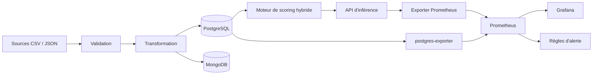
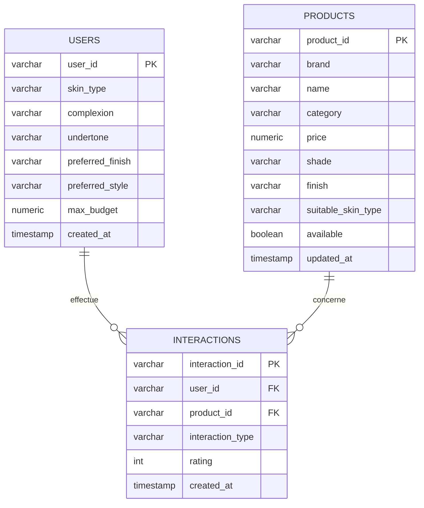
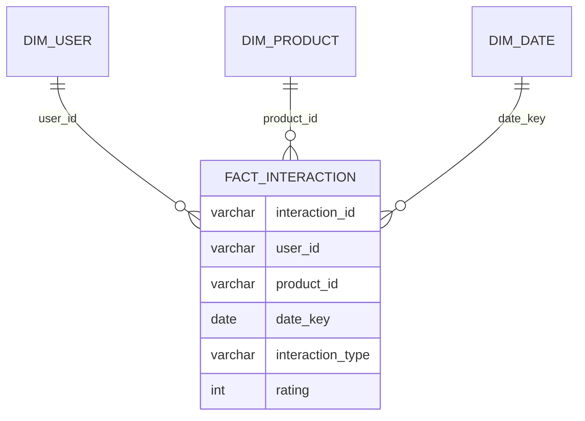
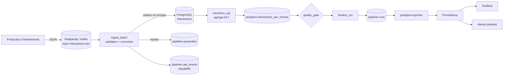
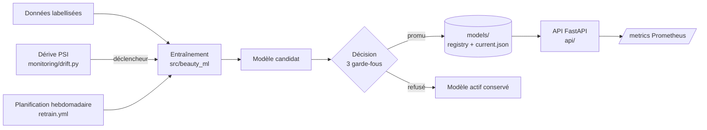

# Beauty Advisor

Plateforme Data/IA de recommandation de routines makeup personnalisées.
Le système combine profils utilisateurs, catalogue produits et interactions pour proposer une routine
(teint, blush, yeux, lèvres) **compatible, dans le budget et expliquée**.

Aucune photo, donnée biométrique, donnée médicale ou tracking de navigation n'est utilisée.
Le type de peau est déclaré par l'utilisateur (pas de diagnostic). Les données sont **synthétiques** (seed 42).

## Structure du dépôt

```text
.
├── app/                 Code Python (pipeline initial, moteur de recommandation, API, tests) + Dockerfile
├── dags/                DAG Airflow du pipeline temps réel (beauty_stream_pipeline)
├── python/              Modules du pipeline : producer, consumer, quality, gate, db
├── sql/                 Schéma du pipeline, transformation ELT, contrôles qualité
├── tests/               Tests unitaires du pipeline (pytest)
├── docker/
│   ├── docker-compose.yml           Pile complète : données, application, monitoring
│   ├── docker-compose.pipeline.yml  Surcouche pipeline : Redpanda (Kafka), producteur, Airflow
│   ├── postgres/                    init.sql, 02_star_schema.sql, pipeline_queries.yaml (métriques)
│   ├── pipeline/ airflow/           Images du producteur et d'Airflow
│   ├── exporter/                    Exportateur Prometheus (API + rapports du modèle)
│   ├── prometheus/                  prometheus.yml + alerts.yml (règles d'alerte)
│   └── grafana/                     Source de données et tableaux de bord provisionnés
├── scripts/             up, check, demo, down, dc, pipeline_up, pipeline_check, pipeline_demo
├── terraform/           Pile principale décrite en Terraform (fournisseur Docker)
├── notebooks/           Notebook d'entraînement et de comparaison des modèles (Bloc 4)
├── src/beauty_ml/       Code du modèle : données, entraînement, évaluation, registre (Bloc 4)
├── models/              Modèles versionnés (v0, v1), registry.json, current.json (Bloc 4)
├── retrain/             Réentraînement automatisé (Bloc 4)
├── monitoring/          Détection de dérive PSI (Bloc 4)
├── api/                 API de serving FastAPI (Bloc 4)
├── k8s/                 Manifests Kubernetes (Bloc 4)
├── Dockerfile           Image de l'API de serving (Bloc 4)
├── .github/workflows/   CI/CD : ci.yml, ml-ci.yml, retrain.yml
├── docs/                Cahier des charges du Bloc 4
├── data/  reports/      Jeux de données et rapports générés
└── README.md
```

## Architecture



Tout tourne dans un réseau Docker privé (`beauty_network`). Les ports sont publiés sur `127.0.0.1`
uniquement. Les services sensibles (API, exporter) sont en lecture seule, sans privilèges
(`cap_drop: ALL`, `no-new-privileges`, utilisateur non-root).

| Couche | Services |
|---|---|
| Données | `postgres` (relationnel), `mongodb` (documents) |
| Application | `app` (pipeline et outils), `api` (inférence, port 8000) |
| Monitoring | `exporter`, `postgres-exporter`, `prometheus`, `grafana` |
| Administration | `pgadmin`, `mongo-express`, `portainer` |

## Démarrage rapide

Prérequis : Docker et Docker Compose v2.

```bash
cp .env.example .env              # renseigner les mots de passe (jamais versionné)
./scripts/up.sh                   # déploie la pile et attend qu'elle soit saine
./scripts/dc.sh exec app python run_bloc4.py --regenerate   # chaîne complète reproductible (seed 42)
./scripts/dc.sh exec app python monitor_model.py --set-reference
./scripts/check.sh                # contrôle de bout en bout
./scripts/demo.sh                 # trafic de démonstration pour le tableau de bord
```

Pour une base déjà créée avant l'ajout du schéma analytique : `./scripts/apply_star_schema.sh`.

| Script | Rôle |
|---|---|
| `scripts/up.sh` | Construit et démarre tous les services, attend l'état « healthy » |
| `scripts/check.sh` | Teste API, Prometheus, Grafana et chaque cible de collecte ; code de sortie non nul en cas d'échec |
| `scripts/demo.sh` | Envoie des requêtes valides et des erreurs volontaires (404, 400) |
| `scripts/dc.sh` | Raccourci `docker compose` (bon fichier, bon `.env`) |
| `scripts/down.sh` | Arrête la pile (`--volumes` supprime aussi les données) |
| `scripts/apply_star_schema.sh` | Crée les vues analytiques sur une base existante |

## Modèle de données

**Relationnel (PostgreSQL)** : 3 tables, 2 clés étrangères avec `ON DELETE CASCADE`, contraintes de
domaine (`interaction_type`, `rating` de 1 à 5) et 4 index.



**Analytique (star schema)** : le schéma `analytics` expose des vues (aucune donnée dupliquée) :
un fait `fact_interaction` et trois dimensions `dim_user`, `dim_product`, `dim_date`.



Exemple : `SELECT * FROM analytics.v_interactions_by_category_skin;`

**Documents (MongoDB)** : profils, produits et interactions enrichis, pour la lecture souple par le moteur.

## API d'inférence

```bash
curl "http://localhost:8000/health"
curl "http://localhost:8000/recommend?user_id=user_001&max_products=4"
curl "http://localhost:8000/metrics"
```

Entrées validées (`user_id` en `[A-Za-z0-9_-]{1,50}`, `max_products` de 1 à 6), erreurs propres (400, 404, 405),
aucun secret dans le service, données en lecture seule, conteneur non-root sans privilèges.

## Monitoring et observabilité

| Élément | Détail |
|---|---|
| Collecte | Prometheus, toutes les 15 s : `exporter` (API et rapports du modèle), `postgres-exporter` (connexions, taille des bases) |
| Tableau de bord | Grafana, `http://localhost:3000` : état API et PostgreSQL, requêtes par minute, erreurs, latence, connexions, taille des bases, décision du suivi du modèle, métriques d'évaluation |
| Alertes | 5 règles dans `docker/prometheus/alerts.yml` (API arrêtée, erreurs > 20 %, latence > 500 ms, PostgreSQL arrêté, suivi du modèle en `alert`), visibles dans Prometheus |
| Vérifications d'état | `healthcheck` sur PostgreSQL, MongoDB, API et exporter |
| Suivi du modèle | `monitor_model.py` : 15 contrôles, décision `ok` / `warning` / `alert`, exposée à Prometheus |

Limite : les règles d'alerte sont évaluées mais aucune notification (e-mail, Slack) n'est branchée.

## Pipeline de données temps réel

Les événements d'interaction (favori, achat, avis) arrivent **en continu** dans un flux Kafka (Redpanda).
Un DAG Airflow les traite par micro-lots toutes les 2 minutes : validation et correction, chargement en
base, transformation SQL, contrôles de qualité. Les données restent **synthétiques** (un producteur Python
génère le flux, dont une part est volontairement dégradée pour exercer les contrôles).



DAG `beauty_stream_pipeline` (planification `*/2 * * * *`, un seul run actif à la fois) :
`init_schema` → `ingest_batch` → `transform_sql` → `quality_gate` → `finalize_run`.

### Lancer le pipeline

```bash
cp .env.example .env            # puis renseigner les mots de passe (dont AIRFLOW_ADMIN_PASSWORD)
./scripts/up.sh                 # pile principale (données, API, monitoring)
./scripts/pipeline_up.sh        # Redpanda, producteur, Airflow (environ 2 Go de mémoire en plus)
./scripts/pipeline_check.sh     # flux, orchestrateur, métriques
./scripts/pipeline_demo.sh      # rafale de 20 000 événements, run du DAG, résultats en base
./scripts/pipeline_demo.sh --dirty   # rafale très dégradée : le portail qualité doit échouer
```

Airflow : `http://localhost:8085` (utilisateur `admin`). Tableau de bord Grafana « Beauty Advisor : pipeline temps réel ».

### Contrôle qualité et correction d'erreurs

| Cas | Traitement |
|---|---|
| Type en majuscules, avec espaces ou en français (`ACHAT`) | **Corrigé** automatiquement, correction tracée |
| Note en texte (`"5"`) | **Corrigée** (conversion en entier) |
| Date invalide ou absente | **Corrigée** (date d'ingestion), tracée |
| Champ obligatoire manquant, type inconnu, note hors de 1 à 5, date future, JSON cassé | **Rejeté** vers `pipeline.quarantine` avec sa raison |
| Utilisateur ou produit inconnu (intégrité référentielle) | **Rejeté** vers `pipeline.quarantine` |
| Doublon (dans le lot ou déjà en base) | Ignoré et compté (`ON CONFLICT DO NOTHING`) |

Portail qualité (`quality_gate`) : taux de rejet ≤ 30 %, fraîcheur ≤ 10 minutes, retard du consommateur
≤ 20 000 messages, 0 violation d'intégrité. Un seuil franchi fait échouer le run (visible dans Airflow,
Grafana et Prometheus).

Reprise sur incident : 2 nouvelles tentatives par tâche (20 s d'écart) ; l'ingestion est idempotente
(offsets validés après le commit en base, upsert sur l'identifiant) : rejouer un lot ne duplique rien.
Les événements en quarantaine restent disponibles pour analyse et rejeu.

### Surveillance du pipeline

Métriques (via les requêtes de `docker/postgres/pipeline_queries.yaml`) : statut et durée du dernier run,
événements lus, chargés, corrigés, rejetés, retard du consommateur, âge du dernier run, quarantaine ouverte.
Quatre règles d'alerte : `PipelineStale`, `PipelineLastRunFailed`, `PipelineRejectionRateHigh`,
`PipelineConsumerLagHigh`.

### Tests

```bash
pip install pytest && python -m pytest tests -q
```

Tests unitaires des règles de qualité, du portail et du producteur ; exécutés par la CI avec la
vérification de syntaxe du DAG.

## Terraform

`terraform/` décrit la même pile avec le fournisseur Docker. Voir `terraform/README.md`.

```bash
cd terraform && cp terraform.tfvars.example terraform.tfvars
terraform init && terraform validate && terraform apply
```

## Méthode du moteur

- **Score de compatibilité** : `0,25 peau + 0,20 fini + 0,20 budget + 0,10 disponibilité + 0,15 interaction + 0,10 historique`.
- **Règle de filtrage** : produit disponible, prix <= budget, compatible avec la peau OU le fini.
- **Routine** : un produit par catégorie d'abord, puis complétion, budget total jamais dépassé.

## CI/CD (GitHub Actions)

Trois tâches à chaque `push` sur `main` : (1) qualité, sécurité et tests unitaires, puis chaîne IA complète ;
(2) validation de l'infrastructure : `docker compose config`, construction des images, `promtool` sur la
configuration Prometheus, JSON du tableau de bord, `terraform validate` ; (3) publication de l'image de l'API
sur GitHub Container Registry. Une exécution planifiée tourne chaque lundi.

Les workflows `ml-ci.yml` (modèle, API, Kubernetes, image de serving) et `retrain.yml` (réentraînement planifié) sont décrits dans la section Bloc 4.

## Bloc 4 : solution d'IA industrialisée (MLOps)

Les poids du score de recommandation sont **appris** par régression logistique, le modèle est **servi** par une API FastAPI, **testé et déployé** par la CI/CD, **réentraîné** automatiquement et **surveillé**. Cahier des charges : `docs/cahier_des_charges_bloc4.md`.

> Deux API coexistent : l'API historique de la pile Docker (`app/api.py`, `GET /recommend`, port 8000) et l'API de serving du Bloc 4 (`api/`, FastAPI, `POST /recommend`), qui charge le modèle actif depuis `models/current.json`.



### Installation et tests

```bash
pip install -r app/requirements.txt -r requirements-ml.txt -r requirements-api.txt
python3 -m pytest tests/ml tests/api -q      # 38 tests (modèle et API)
python3 -m pytest tests -q                   # suite complète
```

### Notebook

```bash
pip install -r requirements-notebooks.txt
python3 -m jupyter nbconvert --to notebook --execute --inplace notebooks/01_exploration_et_entrainement.ipynb
```

Le notebook appelle `src/beauty_ml/` : chargement du découpage entraînement et test, baseline manuelle, validation croisée groupée, poids appris, intervalle de confiance par bootstrap, décision de promotion, dérive.

### Réentraînement et dérive

```bash
python3 retrain/retrain.py --dry-run            # déclencheurs et décision, rien n'est écrit
python3 retrain/retrain.py                      # réentraîne si un déclencheur est actif
python3 retrain/retrain.py --force              # réentraîne sans déclencheur
python3 retrain/retrain.py --rollback           # revient à la version précédente
python3 monitoring/drift.py --simulate          # montre la détection sur des données décalées
```

Un candidat est **promu** seulement si : (1) les six règles métier critiques sont à 100 %, (2) la précision fonctionnelle ne baisse pas de plus de 0,02, (3) l'AUC de contenu gagne au moins 0,01. Sinon le modèle actif est conservé. Déclencheurs : pas de modèle actif, dérive (PSI à partir de 0,25), données modifiées, ou demande manuelle.

### API de serving

```bash
python3 -m uvicorn api.main:app --port 8010     # documentation : http://127.0.0.1:8010/docs
docker build -t beauty-advisor-api .
docker run --rm -p 8010:8000 beauty-advisor-api
```

| Route | Rôle |
|---|---|
| `POST /recommend` | Routine de 4 produits, entrées validées (Pydantic), raisons par produit |
| `GET /health` | État, version du modèle, taille des données |
| `GET /model` | Poids, données d'entraînement (empreinte), métriques du modèle servi |
| `GET /metrics` | Métriques Prometheus : `ba_requests_total`, `ba_request_duration_seconds`, `ba_model_info`, `ba_model_content_auc_test`, `ba_uptime_seconds` |

Clé d'API optionnelle : si la variable `API_KEY` est définie, `POST /recommend` exige l'en-tête `X-API-Key`. Chaque réponse porte un `X-Request-ID`.

### Kubernetes

`k8s/` contient : namespace, configmap, deployment (2 réplicas, sondes, conteneur non-root, filesystem en lecture seule), service, HPA (2 à 5 réplicas), PodDisruptionBudget, kustomization. Les manifests sont validés par `kubeconform` en CI ; **ils n'ont pas été déployés sur un cluster**.

### CI/CD du Bloc 4

| Workflow | Déclencheur | Contenu |
|---|---|---|
| `ml-ci.yml` | Pull Request et `main` | Tests ML et API, réentraînement à blanc, dérive simulée ; validation des manifests (`kubeconform`) ; build de l'image, test de fumée du conteneur, publication sur GHCR depuis `main` uniquement |
| `retrain.yml` | Lundi 06:00 UTC et lancement manuel | Réentraînement, rapport et modèles en artefact, Pull Request automatique si un modèle est promu |

### Limites du Bloc 4

- Données synthétiques et 40 lignes de test : l'écart entre le modèle appris et les poids manuels n'est pas significatif (intervalle de confiance dans le notebook).
- Quatre poids sur six sont appris ; `interaction` et `history_match` restent fixes (risque de fuite de cible).
- Les mêmes utilisateurs sont présents en entraînement et en test : le test mesure le classement de nouveaux produits pour des utilisateurs connus, pas la généralisation à de nouveaux utilisateurs.
- Évaluation fonctionnelle en partie circulaire : garde-fou métier, pas preuve de pertinence réelle.
- Détection de dérive par un PSI implémenté dans le dépôt (pas d'outil externe comme Evidently).
- Métriques de l'API exposées mais pas encore collectées par Prometheus ni affichées dans Grafana ; aucune notification d'alerte.
- Manifests Kubernetes validés, jamais déployés.

## Limites assumées

- Déploiement sur un démon Docker local (on-premise) : conteneurs isolés, pas de machine virtuelle cloud.
- Aucune notification d'alerte, pas de sauvegarde automatisée des volumes, pas de chiffrement au repos.
- Données synthétiques : les volumes réels n'ont pas été testés.
- Pipeline : quasi temps réel par micro-lots de 2 minutes (pas de traitement événement par événement), un seul broker Kafka, Airflow en `SequentialExecutor` avec base SQLite (une tâche à la fois, adapté à une démonstration locale).
- Le rejeu automatique de la quarantaine est prévu mais pas implémenté : les événements rejetés sont conservés avec leur raison.
- La pile Terraform décrit la pile principale ; le pipeline se déploie avec Docker Compose (profil `pipeline`).

